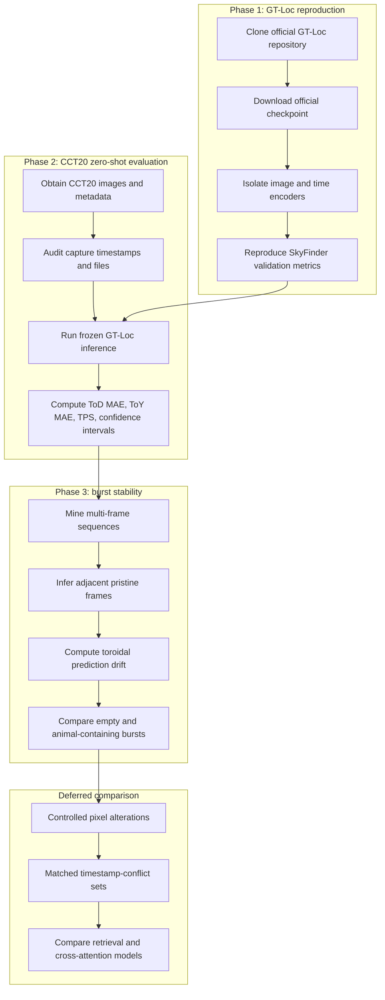

# Study Plan: External Validation of GT-Loc on CCT20

## Scientific objective

This study validates pretrained GT-Loc on the Caltech Camera Traps (CCT20) benchmark at two levels:

- **Level 1 — zero-shot image-to-time generalization:** evaluate the estimator
  \(I \rightarrow \hat{t}=(\hat{h},\hat{m})\) on surveillance-style imagery using
  circular time-of-day (ToD) error, circular time-of-year (ToY) error, and TPS.
- **Level 2 — intra-sequence burst stability:** measure prediction drift across
  near-simultaneous frames from the same trigger sequence.
- **Deferred endpoint:** controlled pixel alterations and direct comparison with
  a multimodal timestamp-consistency classifier.

The phased roadmap is:

1. Reproduce GT-Loc on SkyFinder.
2. Evaluate clean CCT20 images zero-shot.
3. Evaluate intra-sequence burst stability.
4. Defer controlled pixel alteration until the baseline is established.
5. Design matched conflict sets for model comparison.

## Evaluation pipeline

## Phase 1: GT-Loc baseline reproduction and checkpoint setup

### Environment and checkpoint

- Clone the official repository: `https://github.com/dshatwell23/gtloc`.
- Download checkpoint ID `170wGyCYLSF3DWOvITIAbtN1OkmDlS4v6` to
  `ckpts/gtloc.pt`.
- Use the official CLIP ViT-L/14 image backbone and multi-scale Random Fourier
  Feature time encoder.
- Record package versions, runtime type, checkpoint hash, random seed, and all
  deviations from the official evaluation.

### Time-only retrieval isolation

The official evaluator constructs both geographic and temporal retrieval
branches. The study only needs:

- `model.image_encoder`;
- `model.time_encoder`;
- `model/time_galleries/cvt.npy`.

Load only the corresponding checkpoint keys and do not construct or encode the
GPS galleries. Keep the checked-in `cvt.npy` timestamp gallery unchanged so
gallery quantization is identical to the released code. Record its actual row
count at runtime: the paper describes a 100k timestamp gallery, while the
currently released `cvt.npy` file is smaller, so this is a reproducibility
deviation that must be reported rather than silently described as 100k.

### SkyFinder reproduction gate

Use `metadata/skyfinder_val.csv` and the official image preprocessing. The target
published results for the full model are approximately:

- ToY mean error: 1.40 months;
- ToD mean error: 2.72 hours;
- TPS: 77.00.

Phase 2 should begin only after the reproduced result is sufficiently close to
the reference or any discrepancy has been documented. The official repository
does not redistribute SkyFinder images; they must be supplied separately under
the directory structure referenced by `metadata/skyfinder_val.csv`.

## Phase 2: zero-shot evaluation on clean CCT20

### Dataset and manifest

- Use the downsized CCT20 benchmark images (maximum side length 1024 pixels).
- Join the CCT20 split metadata with image-level and bounding-box annotations.
- Build an auditable manifest containing image path, location, capture datetime,
  sequence ID, sequence length, frame number, split, and labels.
- Strictly validate `date_captured` values and record all exclusions.
- Treat every CCT20 camera as unseen by GT-Loc. The CCT20 cis/trans labels refer
  to the animal-recognition benchmark, not GT-Loc training exposure.

### Inference

- Do not train or fine-tune on CCT20.
- Use the same checkpoint, preprocessing, TenCrop setting, and time gallery as
  the successful Phase 1 reproduction.
- L2-normalize image and time embeddings and retrieve the gallery timestamp
  with maximum cosine similarity.
- Save per-image predictions and similarities before aggregation.

### Accuracy metrics

For hour \(h\) on a 24-hour cycle:

\[
d_H(h,\hat{h})=\min\left(|h-\hat{h}|,24-|h-\hat{h}|\right).
\]

For month \(m\) on a 12-month cycle:

\[
d_M(m,\hat{m})=\min\left(|m-\hat{m}|,12-|m-\hat{m}|\right).
\]

Report:

\[
\operatorname{MAE}_{\mathrm{ToD}}=\frac{1}{N}\sum_i d_H(h_i,\hat{h}_i),
\qquad
\operatorname{MAE}_{\mathrm{ToY}}=\frac{1}{N}\sum_i d_M(m_i,\hat{m}_i).
\]

For compatibility with GT-Loc, report:

\[
\operatorname{TPS}
=1-\sqrt{\frac{(\operatorname{MAE}_{\mathrm{ToY}}/6)^2+
(\operatorname{MAE}_{\mathrm{ToD}}/12)^2}{2}}.
\]

Confirm whether TPS is shown on a 0–1 or percentage scale. Estimate 95% bootstrap
confidence intervals clustered by camera location. Stratify results by camera,
official split, hour, month, empty/animal status, and day/night status where it
can be derived reliably.

## Phase 3: motion and burst stability

### Sequence selection

- Group images by `seq_id`.
- Order frames by `frame_num`.
- Retain sequences with at least two valid images.
- Use capture timestamps to verify adjacent elapsed time and identify pairs with
  \(\Delta t \leq 3\) seconds.

### Pairwise toroidal drift

For adjacent predictions, compute:

\[
d_{\mathrm{burst}}(k,k+1)=
\sqrt{
\left(\frac{d_H(\hat{h}_k,\hat{h}_{k+1})}{12}\right)^2+
\left(\frac{d_M(\hat{m}_k,\hat{m}_{k+1})}{6}\right)^2
}.
\]

Pairwise drift is the primary endpoint because it avoids ambiguity from an
arithmetic mean at cyclic boundaries. Report the median, mean, interquartile
range, 90th and 95th percentiles, and proportions below preregistered hour/month
drift thresholds.

A sequence-level variance around a circular or Fréchet mean can be retained as a
secondary endpoint:

\[
\sigma^2_{\mathrm{seq}}=
\frac{1}{K}\sum_{k=1}^{K}
\operatorname{dist}_{\mathbb{T}^2}
\left(\hat{t}_k,\bar{t}_{\mathrm{seq}}\right)^2.
\]

### Foreground robustness

- Compare empty sequences with animal-containing sequences.
- Where bounding boxes are available, compute relative foreground area and its
  Spearman/Pearson association with prediction drift.
- Treat this as an association, not proof that the model attended to foreground
  pixels; exposure changes, flash, compression, and background motion are
  competing explanations.

## Phase 4: controlled pixel alteration benchmark (deferred)

After the baseline:

- splice or mask foreground animals;
- apply directional illumination changes or shadow erasure;
- simulate fog or haze;
- apply JPEG compression, Gaussian noise, or other CCTV artifacts.

Measure:

\[
\delta_{\mathrm{tamper}}=
\operatorname{dist}_{\mathbb{T}^2}
\left(\hat{t}(I_{\mathrm{tampered}}),
\hat{t}(I_{\mathrm{pristine}})\right).
\]

## Later model-comparison study

GT-Loc is an asymmetric image-to-time estimator. A claimed timestamp requires a
post-hoc threshold on cyclic error, while a multimodal cross-attention model can
directly estimate
\(P(\mathrm{authentic}\mid I,t_{\mathrm{claimed}})\).

Construct matched CCT conflict sets:

- hour shifts of \(\pm3\), \(\pm6\), and \(\pm12\) hours;
- season shifts of \(\pm6\) months;
- true burst pairs as pristine controls.

Compare AUROC, AUPRC, F1, and expected calibration error only after Phases 1–3
establish the external baseline.

## Deliverables

- `GTLOC_PHASE1_COLAB.ipynb`: Phase 1 checkpoint setup, time-only isolation, and
  SkyFinder reproduction.
- A validated CCT20 manifest and exclusion log.
- Per-image zero-shot predictions and Level 1 metrics.
- Per-pair burst drift values and Level 2 subgroup analysis.
- A final validation report supporting the subsequent model-comparison design.

